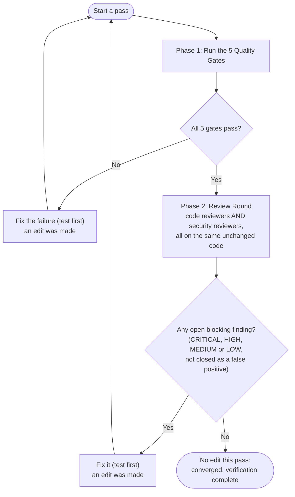

# Verification and Test Suite Validation Rules

These rules govern mandatory verification, test suite execution, code and security reviews, and quality gates that every agent **MUST** satisfy before considering any task, feature, bug fix, or refactoring complete.

> **Command names.** Every `npm run …` script below exists in `package.json` today. Read it again if a
> script seems to be missing; the repository may have changed. If a gate cannot be run (a tool is not
> installed, a browser is missing), say so explicitly in your report instead of claiming the gate
> passed.

> **Origin.** Adapted from the verification and validation rule of the `emoji-selector-for-gnome` project.
> The loop structure is the same; the gates, reviewers and security scope are specific to this
> WebExtension (Firefox and Chromium, Manifest V3, TypeScript, Vitest, Stryker, Playwright).

## 1. The Verification & Validation Convergence Loop

A single review of a change is not enough. An LLM reviewer asked twice about the same code will find
different things the second time, so one clean-looking review proves little. Validation therefore
repeats **one pass** (quality gates, then a review round in which the code reviewers and the security
reviewers all look at the same code) until a pass completes **without any edit**.

An agent is only permitted to leave the loop when a whole pass has made **zero edits**.

An edit that touches only Markdown files re-runs a smaller set of gates (section 1, "What counts as an
edit"). INFO observations and findings closed as false positives are recorded, not counted (section 1,
"Handling findings").

### The Convergence Protocol

1. **Phase 1: Quality Gates.** Run the 5 zero-tolerance quality gates (section 2). If anything fails, fix
   it and **start a new pass from Phase 1**.
2. **Phase 2: Review Round.** Run every applicable reviewer (sections 3 and 4) against the current
   code, in parallel where independent. If any reviewer reports an open blocking finding (CRITICAL,
   HIGH, MEDIUM or LOW), resolve it, then **start a new pass from Phase 1**.
3. **Convergence.** If Phase 1 passed and Phase 2 left no open blocking finding, and **no file was
   edited during the pass**, the loop has converged. Verification is complete.

Why this shape:

- **A fix is never reviewed only by the reviewer that asked for it.** A security fix goes back through
  the gates and then through the code reviewers; a code-review fix goes back through the gates and
  then through the security reviewers. A change made to satisfy one kind of reviewer can introduce a
  problem the other kind would catch (a refactor that widens a message handler, a security patch that
  swallows an error), so both always see the result.
- **A fix is never trusted until the gates have re-run.** Any edit can break a test, drop coverage or
  spawn a mutant.
- **A clean result only counts when nothing changed.** Zero findings from a round that was followed by
  edits says nothing about the edited code.

### Rules for running the loop

- **Fresh reviewers each round.** Start each reviewer anew with the current diff and the project
  context. Do not hand it the previous round's findings or tell it what to look for: the point of
  repeating is to let it notice things the earlier round did not.
- **Reviewers only report.** They never edit. (`a11y-architect` is allowed `Write` and `Edit`; when it
  runs as a reviewer, tell it to report only.) The session that runs the loop (the main session, or
  `@coordinator` in lifecycle mode, which delegates the edits to `@implementer`) makes every change.
  Sub-agents cannot spawn sub-agents, so the loop cannot be delegated whole.
- **What counts as an edit.** Any change to a file in the repository. Regenerated, ignored output
  (`dist/`, `dist-firefox/`, `coverage/`, `reports/`, `.stryker-tmp/`, `web-ext-artifacts/`) does not.
  A change made by a tool counts too (a `pre-commit` hook that fixes whitespace is an edit). Edits are
  of two kinds, and the kind decides what re-runs:
  - **Code edit**: any change to a file that is not Markdown (sources, tests, configuration, manifest,
    locales, `package.json`, lockfile, workflows). Start a new pass from Phase 1 and run every gate.
  - **Markdown-only edit**: every changed file is `*.md` (plans, `docs/spec.md`, `README.md`,
    `AGENTS.md`, and the agent, skill and rule files under `.agents/` and `.github/`). Markdown cannot
    change the build, the mutants or the browsers' behaviour, so Gates 3 (mutation) and 5 (build and
    E2E) are not re-run. Re-run **Gate 1 and Gate 2**, because unit tests read `docs/spec.md`,
    `docs/plans/languages.md` and `README.md`; **Gate 4**, because Prettier checks Markdown; and then a
    new **Review Round** (the security content audit applies to agent files, section 4). The results of
    Gates 3 and 5 from the last code-edit pass still stand.
- **Narrowing during iteration.** While iterating, the unit tests, mutation run (`MUTATE=src/a.ts,src/b.ts`)
  and E2E specs may be narrowed to what the change can affect (see `AGENTS.md`). The **pass that ends
  the loop runs every gate in full**, except that after Markdown-only edits the gates listed above are
  enough.
- **Bounded.** If the loop has not converged after **5 passes**, or a fix undoes an earlier fix, or the
  same finding keeps coming back in a different form, stop and report the sticking point to the user
  with the evidence rather than continuing. (`@coordinator` currently escalates after 3 review cycles;
  that is the stricter limit when it runs the loop.)
- **No commits.** The loop never commits (`AGENTS.md`, Agent Rules). It ends with the changes in the
  working tree.

### Handling findings

- **Blocking and advisory.** CRITICAL, HIGH, MEDIUM and LOW findings are **blocking**: each must be
  fixed or closed as a false positive before the loop can converge. **INFO** is **advisory**: an
  observation or suggestion that needs no action. It does not need an edit and does not restart a pass.
  Record every INFO item for the sign-off report (section 7); the loop owner may fix one anyway (that
  is an edit like any other), and the user may promote one to blocking.
- **INFO is not an escape hatch.** A finding that names a concrete input or state that goes wrong is
  not INFO, whatever its reviewer called it. The loop owner may not lower a finding's severity to avoid
  fixing it; a severity can only be lowered with evidence, as for a false positive.
- **Closing a false positive.** Close it with evidence (the line, the guard or type that already
  handles it) and record both in the report. A closed false positive is not an edit and does not count
  as an open finding. Because every round uses fresh reviewers, a later round may raise the same finding
  again (same place, same failure scenario). Close it again with the recorded evidence and carry on; it
  neither restarts a pass nor counts toward the pass limit. A finding the recorded evidence does not
  answer is a new finding.
- **Reviewers that disagree.** When two reviewers give opposite advice about the same code (inline a
  helper or extract it, add a guard or remove one), do not follow whichever spoke last. Choose the
  option that the project's own rules support (`AGENTS.md`, `docs/spec.md`, the `hexagonal-architecture`
  skill, the gates), record the reason as the closing evidence for the opposed finding, and move on. If
  the rules do not decide it, ask the user instead of cycling.

---

## 2. Phase 1: Zero-Tolerance Quality Gates

Every change to production, test, or configuration code **MUST** pass all five quality gates with 100% compliance.

### Gate 1: Unit Tests (`npm test`)

- **Requirement**: `npm test` (the `lint` gate followed by the Vitest coverage run) passes with **zero
  failures**. `npm run test:unit` runs the Vitest suite alone while iterating.
- **No Skipped Tests**: Existing tests must never be disabled, skipped (`it.skip`, `test.skip`,
  `describe.skip`), narrowed with `.only`, or commented out to force a green suite. No lint rule
  rejects these here (`lint:suppressions` covers coverage, Stryker, type and lint-disable comments only),
  so the 100% coverage threshold and the code reviewers are what catch them.
- **TDD Compliance**: Every new feature or bug fix is preceded by a failing test that passes only after
  the production change. Refactors follow the `test-driven-refactoring` skill (tests and code are not
  changed in the same step). When behaviour is unexpected, write a test to find out why instead of an
  ad hoc script (`AGENTS.md`, section 6).
- **External interfaces are mocked, internals are not.** Use Vitest mocks for `browser.*` and other
  external interfaces; exercise the real modules together otherwise. All storage goes through
  `StateManager`.

### Gate 2: Code Coverage Baseline (`npm run test:coverage`)

- **Requirement**: Coverage stays at a strict **100% baseline** across all four metrics, as enforced by
  `thresholds` in `vitest.config.ts`:
  - **100% Statements**
  - **100% Branches**
  - **100% Functions**
  - **100% Lines**
- **No Coverage Drops**: Every new path, branch (including error handling and default cases) and
  helper is covered.
- No `istanbul ignore` / `c8 ignore` / `v8 ignore` comments unless the user explicitly approves one;
  `lint:suppressions` enforces this.

### Gate 3: Mutation Testing & Zero Surviving Mutants (`npm run test:mutation`)

- **Requirement**: Stryker (`stryker run`) reports a **100.00% mutation score**: `Survived: 0`,
  `NoCoverage: 0`, and, ideally, no timeouts (report any).
- **Configuration enforcement**: `stryker.config.mjs` sets `thresholds.break: 100`, so a surviving
  mutant fails the run.
- **Root-cause resolution**: A surviving mutant means a missing assertion or redundant production code.
  Either:
  1. Add a precise, behavioural assertion that kills it, or
  2. Simplify the production code to remove the unreachable or redundant branch (section 3, "Guards,
     boundaries and mutants", says when a guard is dead code and when it is real).
     Never use `// Stryker disable` comments, exclude files from `mutate`, or lower the thresholds unless
     the user explicitly approves it.

### Gate 4: Static Analysis, Types, Formatting, Hygiene & Dependencies

- **Format first**: `npm run format` (Prettier and `oxlint --fix`), then check:
- **Lint**: `npm run lint` must finish with **0 errors and 0 warnings**. It runs `lint:prettier`,
  `lint:oxlint`, `lint:knip` (unused files, exports and dependencies), `lint:webext` (see Gate 5),
  `lint:typecheck` (`tsc --noEmit`, strict) and `lint:suppressions`.
- **Types**: no `any` escapes and no `@ts-ignore` / `@ts-expect-error` / `oxlint-disable` suppressions
  without an approved reason.
- **Pre-commit**: `pre-commit run --all-files` passes (the hooks cover Prettier, oxlint, knip,
  `no-suppressions`, `lockfile-in-sync`, actionlint and file hygiene). If `pre-commit` is not
  installed in the environment, report that gate as **not verified**; `npm run lint` covers the
  npm-based hooks but not the generic hygiene hooks or actionlint.
- **Dependencies**: `npm run audit:check` (`npm audit --audit-level=low`) reports no vulnerabilities.
  The audit reads the live npm registry, so an advisory can appear in the middle of a run. If the
  advisory is for a package the change added or updated, fix it like any other failure. If it is for a
  package the change did not touch (compare `package-lock.json` against the base), it is not part of
  this task: do not start bumping dependencies. Report the gate as **failed, unrelated to this change**
  with the advisory, and let the user decide. It does not restart the loop and it is not reported as
  passed. The threshold stays at `low`; do not lower it or skip the audit.

### Gate 5: Extension Build, Add-on Validation & Real-Browser E2E

- **Build**: `npm run build` completes cleanly: it compiles with `tsc` (no bundler or minifier, so the
  shipped code stays readable for add-on review), copies the static files into `dist/`, assembles the
  Firefox build in `dist-firefox/` and packages it with `web-ext build`.
- **Add-on validation**: `npm run lint:webext` (the `web-ext lint` run on `dist-firefox/`) must show
  **0 errors, 0 warnings** in its `Validation Summary`. **`web-ext lint` exits 0 when it reports
  warnings** (the repository does not pass `--warnings-as-errors`), so read the summary; never trust
  the exit status alone.
- **End-to-end tests**: `npm run test:e2e` (Playwright, the `firefox` and `chromium` projects; the
  `pretest:e2e` hook builds first) passes on **both** browsers. Every new feature has at least one new
  E2E test (`AGENTS.md`). If a browser cannot be launched in the environment, report that browser as
  **not verified**.
- **What a green E2E run proved.** Chromium runs the real extension. The Firefox page tests run
  against a stand-in `browser`, not the real one, so they prove the page's own code only. Only the
  lab (`tests/e2e/lab/`) runs a real Firefox. Behaviour that exists only in Firefox needs a lab test,
  and the report says which of the three a test ran against (section 7).

---

## 3. Phase 2: Review Round, Code Reviewers

Run these against the change (all applicable ones, in the same round as the security reviewers in
section 4):

| Reviewer agent          | Runs                                                          | Looks at                                                                                                                                           |
| ----------------------- | ------------------------------------------------------------- | -------------------------------------------------------------------------------------------------------------------------------------------------- |
| `code-reviewer`         | Always                                                        | Correctness, readability and simplicity, architecture, performance, missing or weak tests (skill: `hexagonal-architecture` for boundary questions) |
| `silent-failure-hunter` | Always                                                        | Swallowed errors, bad fallbacks, lost errors in message handlers and storage code, partial teardown                                                |
| `type-design-analyzer`  | When types, interfaces, schemas or stored data shapes changed | Invariants, illegal states made representable, validation at the boundary                                                                          |
| `a11y-architect`        | When popup, sidebar, options page, HTML or CSS changed        | Keyboard use, focus, labels, contrast, RTL and locale text growth                                                                                  |

The agents live in `.agents/agents/`. `@reviewer` (Copilot) covers code and security together; where it
is the available reviewer, its report counts for both. Its `PASS` means "no open CRITICAL, HIGH,
MEDIUM or LOW finding and the E2E tests pass" (`AGENTS.md`), the same threshold as this rule, with INFO
advisory. It is still one round by one reviewer, so its `PASS` is not convergence: the gates, the other
reviewers and a pass with zero edits are still required (section 1).

1. **Review dimensions**:
   - **Correctness**: spec conformance (`docs/spec.md`), boundary conditions, edge cases, error propagation.
   - **Readability & simplicity**: clear naming, flat control flow, no dead code, no magic numbers
     (shared constants live in `src/js/core/constants.ts`).
   - **Architecture**: module boundaries, dependency direction, `StateManager` as the only route to
     `browser.storage` and `browser.sessions`, no module-level shared mutable state.
   - **Tests**: every behaviour asserted strongly enough to kill its mutants; mocks reflect the real
     `browser.*` behaviour; a new feature has its E2E test.
   - **Performance**: no unbounded loops, no needless work on every tab or group event, no leaked
     listeners.
   - **No new scripts**: the change adds no file under `scripts/` or `tools/`, no `package.json` script
     entry, and no throwaway shell, Python or `node -e` helper, unless the user approved it (section 6).
2. **Remediation**:
   - Address **every blocking finding** (CRITICAL, HIGH, MEDIUM or LOW) with a concrete change, tests
     first. INFO items are recorded, not fixed (section 1, "Handling findings").
   - A finding may be closed without a change only by showing it is a **false positive, with
     evidence** (the line, the guard that already handles it), recorded in the report.
   - Anything that makes an edit starts a new pass from Phase 1 (section 1).
3. **A finding must be grounded.** A reviewer cites the file and line and names the input or state that
   goes wrong. A vague finding ("consider adding error handling") is asked for evidence or closed. A
   clean review is a valid result; reviewers are not asked to find something.
4. **Guards, boundaries and mutants.** `silent-failure-hunter` pushes for guards and fallbacks; Gate 3
   kills the mutants of every guard. Settle it in this order:
   - Check external and untyped data **once, at the boundary** (adapters, message handlers, storage
     reads, imports) and turn it into a type that cannot hold the bad state (`type-design-analyzer`,
     `hexagonal-architecture`). Code inside the boundary relies on its types and does not re-check what
     they already exclude.
   - A guard for a state the types **do** allow is real, such as the optional `tab.id` on a browser
     tab. Keep it and test it with that input; that test is not contrived.
   - A guard for a state that neither the types nor any caller can produce is dead code. Remove it. Do
     not write a test that mocks the impossible state, and do not suppress the mutant (Gate 3). A
     reviewer's request for such a guard is closed as a false positive, with the boundary that already
     excludes the state as the evidence.
   - Where a state is unexpected but possible (a browser lifecycle event, a failed storage read), prefer
     an explicit error or logged path with a test over a silent early `return`.

---

## 4. Phase 2: Review Round, Security Reviewers

Run these in the same round as section 3. Run `security-reviewer` always, loading the project skill
`webext-security` (`.github/skills/webext-security`) first. Also run it as a content audit whenever
anything under `.agents/`, `.claude/`, `.github/agents`, `.devcontainer/` or `AGENTS.md` changed or
was imported (see "Agent and tooling content" below).

1. **Audit scope**: inspect all modified files, touched components and data paths:
   - **Messaging**: `runtime.onMessage` / `onMessageExternal` handlers validate `sender` and the
     message shape; no `externally_connectable` widening.
   - **DOM XSS**: no `innerHTML`, `outerHTML`, `insertAdjacentHTML`, `document.write`, `eval`,
     `new Function` or string `setTimeout` in extension pages with data that came from tabs, groups,
     titles, storage or imports. Use `textContent` and DOM APIs.
   - **Permissions**: any addition to `permissions`, `optional_permissions` or `host_permissions` in
     `src/manifest.json` needs a stated reason and must be the least that works. The Firefox
     `data_collection_permissions` declaration (`required: ["none"]`) stays true: no new collection,
     telemetry or network access without an explicit decision by the user.
   - **Content scripts and CSP**: isolation preserved, no relaxed content security policy, no remote
     code, no dynamic `executeScript` with built strings.
   - **Stored and imported data**: everything read back from `browser.storage` or an imported file is
     validated before use as an index, key, size, URL or HTML fragment. Tab titles and URLs are private
     user data: not logged, not sent anywhere.
   - **Secrets**: no API keys, tokens or credentials in source, tests, fixtures or logs.
   - **Dependencies and supply chain**: the extension ships zero runtime dependencies (devDependencies
     only); keep it so. Versions stay pinned, `package-lock.json` in sync, CI actions pinned, no
     `curl | sh`, no committed build artefacts. `npm run audit:check` is clean (Gate 4).
   - **Shell scripts and CI**: `set -euo pipefail`, quoted expansions, no `rm` on unchecked variables;
     workflow permissions kept minimal.
   - **Add-on review readiness**: readable, unobfuscated source; manifest and locales valid; nothing
     that would block a listing review.
   - **Agent and tooling content**: files under `.agents/`, `.github/agents`, `.claude/` and
     `.devcontainer/` are read as content: embedded instructions aimed at an agent, hooks, scripts or MCP
     servers, and URLs that are fetched. Imported material has its row and checksum in
     `.agents/EXTERNAL-SOURCES.md` and differs from its source only by Prettier.
2. **Remediation**:
   - Blocking findings (CRITICAL, HIGH, MEDIUM, LOW) are addressed with a rigorous patch and a
     regression test (tests first, as in Gate 1). INFO items are recorded for the sign-off report.
   - The patch starts a new pass from Phase 1, so it is re-gated and then re-reviewed by the **code**
     reviewers as well as the security reviewers.

---

## 5. Mandatory Verification Sequence Within a Pass

Within each pass, execute in this order:

1. **TDD red-green**: `npm run test:unit` during development to see the test fail, then pass.
2. **Format, lint, types, hygiene**: `npm run format`, `npm run lint`, `pre-commit run --all-files`,
   `npm run audit:check`.
3. **Full coverage**: `npm run test:coverage` (all four metrics at 100%).
4. **Mutation testing**: `npm run test:mutation` (100.00% score).
5. **Build, add-on validation, E2E**: `npm run build`, `npm run lint:webext` (read the summary), then
   `npm run test:e2e`.
6. **Review Round**: code reviewers and security reviewers, together (sections 3 and 4).
7. **Convergence check**: if a code edit was made in this pass, start again from step 1. After a
   Markdown-only edit, start again from step 1 but run only the gates named in section 1 (Gates 1, 2 and
   4, then the Review Round). If nothing was edited, stop.

---

## 6. Diagnostic Guidelines

- **No ad hoc scripts. Debug with tests.** To understand unexpected behaviour, write a test (a Vitest
  test, or a Playwright test for browser behaviour) that reproduces it, and keep it if it is worth
  keeping. Do not write a script instead, and do not add scripts to the project. That covers files in
  `scripts/` or `tools/`, new `package.json` script entries, throwaway shell or Python helpers, and inline
  `node -e` or `tsx -e` commands, whether they live in the repository or in a scratch directory.
  `scripts/` already holds more of these than it should; this rule exists so it does not grow. To read
  output, use the existing `npm run` scripts, the tools' own reporters and the file reading and search
  tools. A new script needs the user's explicit approval, stated in the task, and the code reviewers
  flag one that was added without it.
- **Surviving mutants.** Read the `clear-text` output, or `reports/mutation/index.html`, to see the exact
  mutant. `MUTATE=src/a.ts npm run test:mutation` narrows a run while iterating.
- **Incremental state.** Stryker is `incremental` (`reports/stryker-incremental.json`). If the cache looks
  out of sync, run `npm run test:mutation:full` (`--force`) or remove the stale file rather than
  disabling a mutation rule.

---

## 7. Final Sign-Off and Reporting

An agent **MUST NOT** conclude a task, report completion or request review without explicitly confirming
that **the loop has converged with zero edits on its final pass**, and stating the verified status of
every gate:

- **Convergence**: number of passes; the final pass made 0 edits
- **Unit tests**: pass count, 0 failures
- **Coverage**: Statements 100%, Branches 100%, Functions 100%, Lines 100%
- **Mutation score**: 100.00% (0 survived, 0 no-coverage, timeouts reported)
- **Lint, types, suppressions, pre-commit, audit**: 0 errors, 0 warnings, 0 vulnerabilities
- **Build and `web-ext lint`**: clean (0 errors, 0 warnings in the summary)
- **E2E**, as three lines: Chromium (real extension) passed; Firefox page tests (stand-in `browser`)
  passed; Firefox lab tests (real Firefox) passed or "none apply", with the reason
- **Code review** (code-reviewer, silent-failure-hunter, plus type-design-analyzer / a11y-architect when
  they applied): 0 open blocking findings (CRITICAL to LOW) on the final pass
- **Security review** (security-reviewer, plus the content audit when it applied): 0 open blocking
  findings (CRITICAL to LOW) on the final pass
- **INFO observations**: each listed, with the reviewer that raised it
- **False positives closed**: each with its evidence
- **Dependency advisories unrelated to this change**: each listed, not reported as a pass
- **Not verified**: anything that could not be run, with the reason

If any item could not be verified (tool unavailable, browser missing, narrowed run), state it as
**not verified** with the reason. Do not report it as passed.
